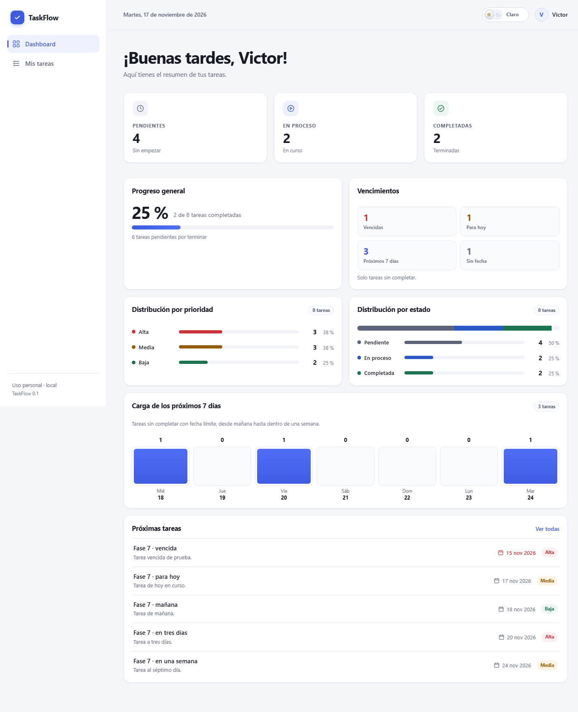
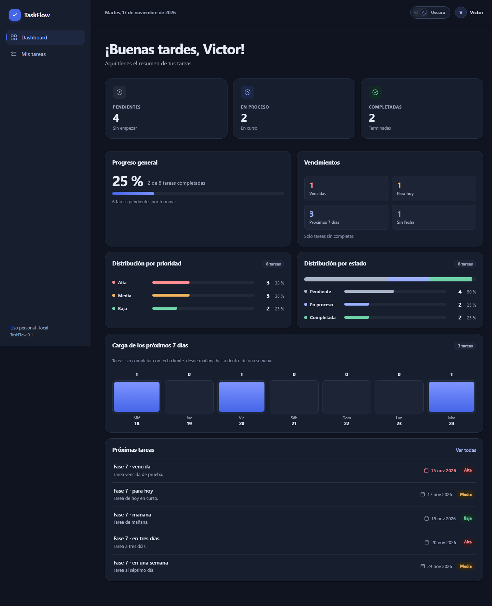
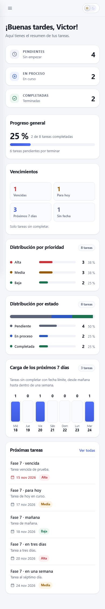
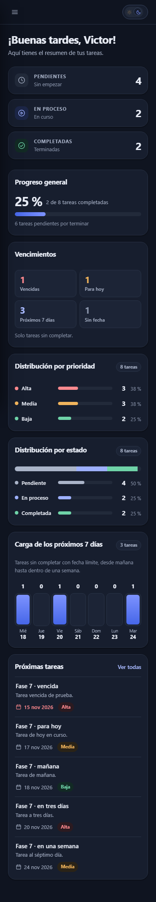
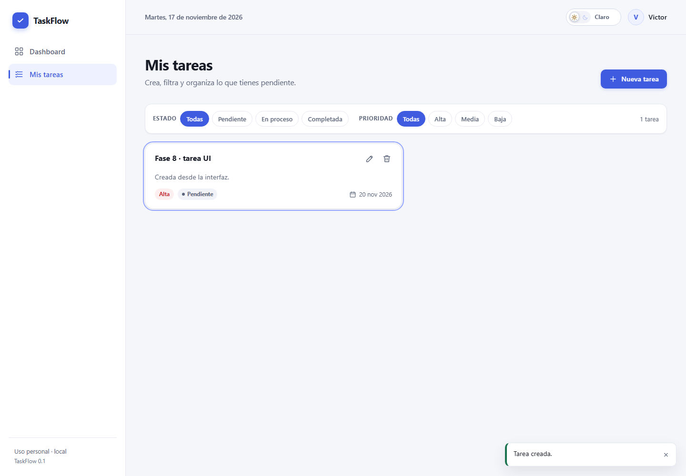

# TaskFlow

Gestor de tareas personales **de un solo usuario**: prioridades, fechas límite,
estados, filtros y dashboard de estadísticas.

Proyecto de portfolio para el ciclo de **Desarrollo de Aplicaciones Web (DAW)**.

> **Estado actual: Fase 9 verificada, pendiente de aprobación.**
> Las fases 1–8 están completadas. TaskFlow ya no tiene registro ni login: es una
> aplicación **local y privada** pensada para ejecutarse en tu equipo, no en un
> servidor público. El backend arranca contra MySQL 8, Flyway aplica `V1` y `V2`,
> `GET /api/health` responde `200` y la interfaz **trabaja con datos reales**.
> La Fase 9 añadió arranque y parada con un solo comando, accesos directos de
> escritorio, logs, guía de uso diario y pruebas reales de persistencia, copia y
> restauración. Resultado: **34 tests, 53 comprobaciones de API, 98 de interfaz y
> 134 de regresión**, con la base a **0 tareas** y TaskFlow parado. Sigue habiendo
> **0 commits**: la publicación espera autorización expresa.

> **Aviso de seguridad:** la aplicación escucha solo en `127.0.0.1` y no tiene
> autenticación. No la expongas en internet: para publicarla habría que añadir
> antes autenticación y HTTPS.

---

## Stack

| Capa | Tecnología |
|---|---|
| Lenguaje | Java 21 (bytecode) sobre JDK 21 o superior |
| Backend | Spring Boot 3.5.16, Spring MVC, Spring Data JPA |
| Base de datos | MySQL 8.0+ + Flyway |
| Tests | JUnit 5, MockMvc, H2 (solo tests) |
| Frontend | HTML5, CSS3 y JavaScript vanilla (sin frameworks) |
| Build | Maven Wrapper (no requiere Maven instalado) |

Sin frameworks frontend, sin dependencias JS externas.

---

## Requisitos

- **JDK 21 o superior** (probado con Temurin 25 en Windows 11).
- **MySQL 8.0+** en marcha en `localhost:3306`, preferiblemente con
  `bind-address=127.0.0.1`.
- Conexión a internet la primera vez, para que Maven descargue sus dependencias.

No necesitas Maven, Node, Docker, un IDE ni un servidor web. La guía completa de
instalación, traslado y copias de seguridad está en
[INSTALACION.md](INSTALACION.md).

---

## Puesta en marcha rápida

### 1. Crear la base de datos y el usuario

Abre **MySQL Workbench**, conéctate como `root` y ejecuta
[`database/00_create_database_and_user.sql`](database/00_create_database_and_user.sql)
cambiando antes `CAMBIA_ESTA_CONTRASENA`.

Alternativa por consola, desde la carpeta del proyecto (requiere `mysql` en el
`PATH`):

```powershell
cmd /c "mysql -u root -p < database\00_create_database_and_user.sql"
```

Comprueba el resultado con [`database/01_verify.sql`](database/01_verify.sql).
**No concedas privilegios globales**: el usuario solo necesita permisos sobre
`taskflow.*`.

### 2. Configurar la contraseña

```powershell
cd <ruta-del-proyecto>
.\scripts\set-db-password.ps1
```

El script pide la contraseña una sola vez (no se muestra por pantalla) y la guarda
en `.env.local`, que está ignorado por Git. El script de arranque carga ese archivo
automáticamente; no hace falta cargar el entorno a mano.

Si vas a usar Maven directamente, carga también el JDK y el entorno:

```powershell
. .\scripts\set-dev-env.ps1
```

También puedes definir la contraseña manualmente en la sesión:

```powershell
$env:TASKFLOW_DB_PASSWORD = "la_contrasena_de_taskflow_app"
```

Nunca escribas la contraseña en `application.yml` ni en archivos versionados.

### 3. Arrancar y comprobar

```powershell
.\scripts\start-taskflow.ps1
```

El script carga el entorno, comprueba Java, MySQL y el puerto 8080, arranca
Spring Boot en segundo plano, espera a que `/api/health` esté `UP` y abre
**http://localhost:8080**. La primera ejecución descarga Maven 3.9.16 y las
dependencias en `%USERPROFILE%\.m2`; si tarda, usa `-TimeoutSeconds 180`.

Para parar:

```powershell
.\scripts\stop-taskflow.ps1
```

Guía completa de uso diario: [Uso diario en Windows](docs/USO-DIARIO.md).

---

## Comandos habituales

| Comando | Para qué |
|---|---|
| `.\scripts\start-taskflow.ps1` | Arrancar, comprobar health y abrir `localhost:8080` |
| `.\scripts\stop-taskflow.ps1` | Parar TaskFlow y liberar el puerto 8080 |
| `.\scripts\create-shortcuts.ps1` | Crear los accesos directos del escritorio |
| `.\mvnw.cmd -v` | Ver versión de Maven y de Java en uso |
| `.\scripts\start-taskflow.ps1 -Foreground` | Arranque manual en primer plano (depuración) |
| `.\mvnw.cmd test` | Ejecutar los tests (H2, no necesitan MySQL) |
| `.\mvnw.cmd clean package` | Generar el `.jar` en `target/` |
| `.\scripts\backup-db.ps1` | Copia completa de la base de datos en `backups/` |
| `.\scripts\restore-db.ps1 -BackupFile <archivo.sql>` | Restaurar una copia (pide confirmación) |
| `.\scripts\check-no-secrets.ps1` | Verificar que ningún secreto está escrito en el proyecto |

---

## Comprobar que funciona

```powershell
.\scripts\start-taskflow.ps1
```

El script ya espera a que la aplicación esté lista. En otra ventana de PowerShell:

```powershell
Invoke-RestMethod http://localhost:8080/api/health | ConvertTo-Json
```

Respuesta esperada:

```json
{
  "status": "UP",
  "application": "taskflow",
  "database": "UP",
  "timestamp": "2026-11-17T09:50:00Z"
}
```

El endpoint ejecuta `SELECT 1` contra MySQL. Si la base de datos no responde,
devuelve `503` y `"database": "DOWN"`.

Abre **http://localhost:8080** en el navegador para ver la interfaz.

La aplicación escucha **solo en `127.0.0.1`** (`server.address` en
`application.yml`): el puerto 8080 no queda accesible desde la red local.

---

## Calidad y pruebas

| Nivel | Resultado |
|---|---|
| Tests del backend con H2 (`.\mvnw.cmd test`) | **34 / 34**, sin fallos |
| API real contra MySQL (CRUD, validación, HTTP, filtros) | **53 / 53** |
| Interfaz real en Chrome (diálogos, teclado, red, responsive, tema) | **98 / 98** |
| Regresión del dashboard y modo oscuro de la Fase 7 | **134 / 134** |
| Arranque, parada, accesos directos y protección de procesos ajenos | **8 / 8 escenarios** |
| Persistencia tras parar y volver a arrancar | **1 / 1** tarea conservada |
| Copia real de la base | Archivo de 3,6 KB con `tareas` y Flyway |
| Restauración: archivo inexistente, sin tablas, app en marcha y cancelación | **4 / 4** negativas correctas |
| Restauración en base de pruebas | **No ejecutada**: faltan permisos de MySQL |
| Contraste WCAG AA | 18 pares en claro y 18 en oscuro, todos ≥ 4.5:1 |
| Secretos, peticiones externas y consola | Sin secretos, sin peticiones externas, sin errores inesperados |
| MySQL al empezar y al terminar | **0 tareas**; Flyway `V1` y `V2` correctas |

La Fase 9 no encontró defectos en la aplicación. Sí documentó dos asuntos
externos: MySQL escucha en todas las interfaces (mitigado por el firewall) y la
base de pruebas de restauración necesita permisos que `taskflow_app` no tiene.
El detalle y las evidencias están en [Fase 9](docs/colaboracion/FASE-09.md); las
pruebas de la Fase 8, en [Fase 8](docs/colaboracion/FASE-08.md); la guía para
repetirlas, en [Pruebas y calidad](docs/aprendizaje/09-pruebas-y-calidad.md).

---

## Copias de seguridad

La copia debe incluir **toda** la base `taskflow`: la tabla `tareas` y el
historial de Flyway. Restaurar solo `tareas` rompería las migraciones.

```powershell
.\scripts\backup-db.ps1
```

Se crea `backups\taskflow-AAAA-MM-DD_HHmmss.sql`. La carpeta `backups/` está
ignorada por Git porque contiene datos personales. En la Fase 9 se creó una copia
real de 3,6 KB con las tablas `tareas` y `flyway_schema_history`.

Para restaurar (con TaskFlow parado):

```powershell
.\scripts\stop-taskflow.ps1
.\scripts\restore-db.ps1 -BackupFile ".\backups\taskflow-2026-11-17_120000.sql"
```

El script comprueba el archivo, se niega a continuar si el puerto 8080 está
ocupado y pide escribir `RESTAURAR`. La restauración real sobre `taskflow` **no se
ejecutó** en la Fase 9 para no tocar datos personales. Para probarla sin riesgo
hace falta una base independiente; los permisos necesarios están en
[INSTALACION.md](INSTALACION.md#probar-una-restauración-sin-tocar-tus-datos).
Instrucciones completas, incluido el traslado a otro ordenador:
[INSTALACION.md](INSTALACION.md) y
[Base de datos y Flyway](docs/aprendizaje/02-base-de-datos.md).

---

## API de tareas

| Método | Ruta | Qué hace | Respuesta |
|---|---|---|---|
| `GET` | `/api/tareas` | Lista todas las tareas | `200` |
| `GET` | `/api/tareas?estado=PENDIENTE&prioridad=ALTA` | Filtra por estado y/o prioridad | `200` |
| `GET` | `/api/tareas/{id}` | Devuelve una tarea | `200` / `404` |
| `POST` | `/api/tareas` | Crea una tarea | `201` + `Location` / `400` |
| `PUT` | `/api/tareas/{id}` | Actualiza una tarea | `200` / `400` / `404` |
| `DELETE` | `/api/tareas/{id}` | Elimina una tarea | `204` / `404` |

Ejemplo:

```powershell
$cuerpo = @{
  titulo     = "Preparar entrega"
  descripcion = "Modulo de desarrollo"
  prioridad  = "ALTA"
  fechaLimite = "2026-12-31"
} | ConvertTo-Json

Invoke-RestMethod -Method Post -Uri http://localhost:8080/api/tareas `
  -ContentType "application/json" -Body $cuerpo
```

Los errores usan siempre el mismo formato:

```json
{
  "timestamp": "2026-11-17T10:00:00Z",
  "status": 400,
  "error": "Bad Request",
  "mensaje": "La peticion no es valida",
  "ruta": "/api/tareas",
  "campos": { "titulo": "El titulo es obligatorio" }
}
```

Guía completa: [API REST de tareas](docs/aprendizaje/05-api-tareas.md).

---

## Interfaz

La interfaz está hecha con HTML, CSS y JavaScript sin frameworks: menú lateral,
dashboard con saludo personalizado, listado de tareas, filtros y formularios en
diálogos nativos. Es responsive y se puede usar solo con teclado.

El dashboard muestra progreso general, vencimientos (vencidas, para hoy, próximos
7 días y sin fecha), distribución por prioridad y por estado, carga de los próximos
7 días y las próximas tareas. Todo se calcula en el navegador sobre la única
petición `GET /api/tareas`; no hay endpoints de estadísticas ni cambios de backend.

El **tema claro/oscuro** se elige con un interruptor de dos estados en la cabecera.
Al abrir por primera vez se respeta la preferencia del sistema; después manda la
última elección guardada en `localStorage`. El cambio se aplica a todas las vistas,
diálogos, tarjetas y avisos, y respeta `prefers-reduced-motion`.

Todas las operaciones van contra MySQL: las tareas se cargan con `GET`, se crean
con `POST`, se editan con `PUT` y se eliminan con `DELETE`. La interfaz muestra
estados de carga, error con reintento y vacío, y avisa al terminar cada operación.





| Móvil claro (390 px) | Móvil oscuro (390 px) |
|---|---|
|  |  |



> Las capturas se tomaron con tareas reales creadas y borradas durante la
> verificación. La base de datos quedó vacía al terminar. La Fase 8 añadió las
> capturas del estado vacío, el error de red, el tema oscuro y el menú móvil; están
> en [Fase 8](docs/colaboracion/FASE-08.md#9-capturas-revisadas).

Guía completa: [Frontend](docs/aprendizaje/06-frontend.md) e
[Integración con la API](docs/aprendizaje/07-integracion-api.md).

---

## Primera publicación en GitHub (pendiente)

TaskFlow está preparado para publicarse, pero **no se ha hecho ningún commit ni
push**. El repositorio remoto configurado es
`https://github.com/Viticp/TaskFlow.git`; a 17/11/2026 devuelve `404` sin
autenticación y la cuenta no tiene repositorios públicos, así que hay que crear el
repositorio (privado inicialmente) antes del primer push.

Antes de publicar:

1. Configura la identidad de Git (`user.name` y `user.email`).
2. Crea el repositorio privado en GitHub y confirma la URL de `origin`.
3. Ejecuta `.\scripts\check-no-secrets.ps1`.
4. Revisa que `.env.local`, `backups/`, `logs/` y `target/` no estén en el índice.
5. Revisa las capturas por si contuvieran datos personales.
6. Autoriza expresamente el primer commit.

Comprobación de secretos:

```powershell
.\scripts\check-no-secrets.ps1
```

Compara el valor real de cada variable sensible de `.env.local` con el contenido
de todos los archivos del proyecto. Si encuentra una contraseña escrita en algún
archivo, sale con código 1 y te dice cuál. Así se evita que un secreto entre en
el historial de Git, de donde es muy difícil sacarlo.

Cuando se autorice, el primer commit puede ser único y llevar etiqueta `v1.0.0`:

```text
feat: TaskFlow 1.0.0 - gestor personal de tareas

- Spring Boot 3.5, MySQL 8 y Flyway
- API REST y frontend sin frameworks
- Arranque, parada, copias y restauración para Windows 11
- Documentación de instalación, uso diario y fases
```

**Licencia:** MIT si el repositorio se hace público. Mientras siga siendo privado
no se ha añadido `LICENSE`; la decisión queda documentada en la Fase 9.

Para llevar el proyecto y los datos a otro ordenador, sigue
[Trasladar TaskFlow a otro ordenador](INSTALACION.md#8-trasladar-taskflow-a-otro-ordenador).

---

## Estructura

```text
taskflow/
├─ pom.xml                  Dependencias y configuración de Maven
├─ mvnw / mvnw.cmd          Maven Wrapper (Maven sin instalar)
├─ .mvn/wrapper/            Versión de Maven y su lanzador
├─ database/                Scripts SQL administrativos (los ejecuta la persona)
├─ INSTALACION.md           Guía de instalación, traslado y copias de seguridad
├─ scripts/set-dev-env.ps1  Entorno de desarrollo y detección portable del JDK
├─ scripts/set-db-password.ps1  Guarda la contraseña en .env.local (ignorado)
├─ scripts/start-taskflow.ps1  Arranque diario con health, log y PID
├─ scripts/stop-taskflow.ps1   Parada segura y liberación del puerto 8080
├─ scripts/create-shortcuts.ps1  Accesos directos del escritorio
├─ scripts/backup-db.ps1    Copia completa de taskflow en backups/
├─ scripts/restore-db.ps1   Restauración con comprobaciones y confirmación
├─ scripts/mysql-utils.ps1  Funciones comunes de los scripts de MySQL
├─ scripts/check-no-secrets.ps1  Comprueba que ningún secreto está escrito en el proyecto
├─ .env.example             Variables necesarias, sin valores reales
├─ backups/                 Copias locales (ignorado por Git, no se versiona)
├─ logs/                    Logs de arranque (ignorado por Git)
├─ docs/                    Guías de aprendizaje y coordinación
├─ docs/USO-DIARIO.md       Guía corta de arranque, parada y copias
├─ docs/capturas/           Capturas reales de la interfaz
└─ src/
   ├─ main/
   │  ├─ java/com/taskflow/ task (tareas) y common (errores)
   │  └─ resources/
   │     ├─ application.yml Configuración (sin contraseñas)
   │     ├─ db/migration/   Migraciones Flyway
   │     └─ static/         index.html, css/, js/ (api.js + app.js + tema.js) e img/
   └─ test/                 Tests con H2
```

---

## Documentación para aprender

- [Arquitectura y flujo de una petición](docs/aprendizaje/01-arquitectura.md)
- [Base de datos y Flyway](docs/aprendizaje/02-base-de-datos.md)
- [Entorno, Java y Maven Wrapper](docs/aprendizaje/03-entorno-y-maven.md)
- [Arranque, configuración y health](docs/aprendizaje/04-arranque-y-health.md)
- [API REST de tareas](docs/aprendizaje/05-api-tareas.md)
- [Frontend](docs/aprendizaje/06-frontend.md)
- [Integración con la API](docs/aprendizaje/07-integracion-api.md)
- [Pruebas y calidad](docs/aprendizaje/09-pruebas-y-calidad.md)
- [Instalación y traslado a otro ordenador](INSTALACION.md)
- [Uso diario en Windows](docs/USO-DIARIO.md)
- [Cierre del proyecto (Fase 9)](docs/colaboracion/FASE-09.md)
- [Protocolo de colaboración Hermes ↔ OpenCode](docs/colaboracion/PROTOCOLO.md)

---

## Seguridad y alcance

TaskFlow es una aplicación **personal y local**. Esta decisión es deliberada:

- **No hay autenticación.** No existen usuarios, contraseñas ni sesiones. Por eso
  tampoco hay CSRF que proteger: no hay cookies de sesión que el navegador envíe
  automáticamente.
- **Solo accesible en local.** Spring Boot escucha en `127.0.0.1:8080`, así que el
  puerto no se abre a la red local. MySQL debe configurarse igual
  (`bind-address=127.0.0.1` en `my.ini`). Instrucciones en
  [INSTALACION.md](INSTALACION.md).
- **MySQL en este equipo (17/11/2026).** Escuchaba en `::` (todas las interfaces) y
  `my.ini` no tenía `bind-address`. El firewall mantiene las reglas de entrada de
  `mysqld` en **Block**, así que la red no podía conectar, pero la configuración no
  cumple la recomendación. La Fase 9 no modificó MySQL; el procedimiento con
  permisos de administrador está en
  [INSTALACION.md](INSTALACION.md#incidencia-conocida-en-este-equipo-17112026).
- **No debe exponerse en internet.** Tal cual está, cualquiera con acceso al equipo
  puede leer y modificar las tareas. Para publicarla habría que añadir
  autenticación, HTTPS y una revisión de seguridad.
- **Credenciales de base de datos fuera del repositorio.** Se leen de variables de
  entorno; `.env.local` está ignorado por Git.
- **Copias de seguridad privadas.** `backups/` y `*.dump` están ignorados por Git
  porque contienen tareas personales.
- **Errores sin detalles internos.** `server.error.include-message` y
  `include-stacktrace` están desactivados.
- **Comprobación de secretos.** `scripts/check-no-secrets.ps1` verifica antes de
  cada commit que ninguna contraseña quedó escrita en un archivo versionado.

---

## Fases del proyecto

La adaptación a un solo usuario no consume número de fase: se documenta aparte en
[Adaptación a un solo usuario](docs/colaboracion/ADAPTACION-UN-SOLO-USUARIO.md).
La adaptación de portabilidad (antes de la Fase 7) se documenta en
[Portabilidad](docs/colaboracion/PORTABILIDAD.md). El detalle y la verificación de
la Fase 7 están en [Fase 7](docs/colaboracion/FASE-07.md); las pruebas, la
seguridad y las correcciones de la Fase 8, en
[Fase 8](docs/colaboracion/FASE-08.md); el cierre, el uso diario y la preparación
de la publicación, en [Fase 9](docs/colaboracion/FASE-09.md).

| Fase | Estado |
|---|---|
| 1. Análisis del entorno | ✅ |
| 2. Base de datos y estructura | ✅ |
| 3. Configuración del backend | ✅ |
| 4. Modelo y API REST de tareas | ✅ |
| 5. Frontend | ✅ |
| 6. Integración | ✅ |
| 7. Dashboard y modo oscuro | ✅ |
| 8. Pruebas y correcciones | ✅ |
| 9. Cierre, uso diario y publicación | 🟡 verificada, pendiente de aprobación |
