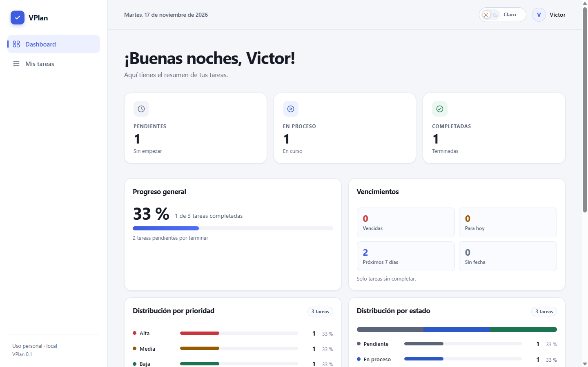
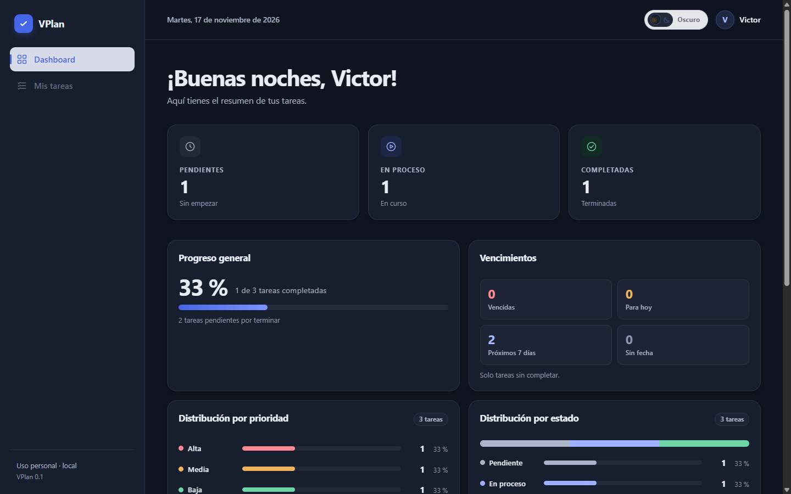
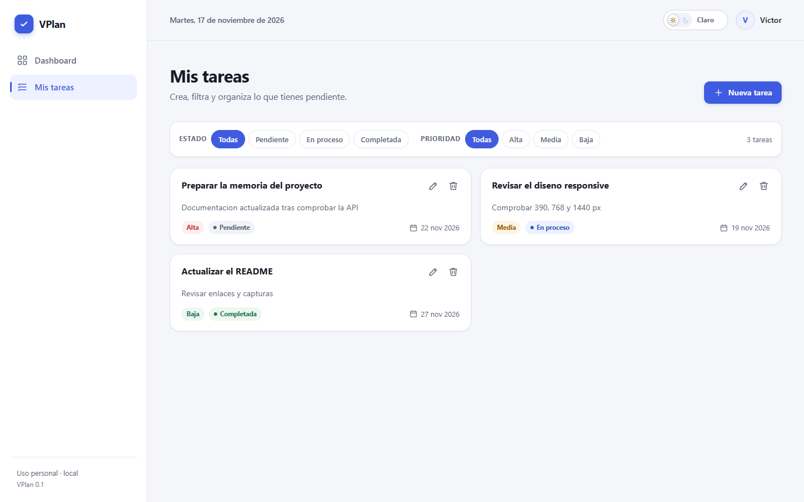
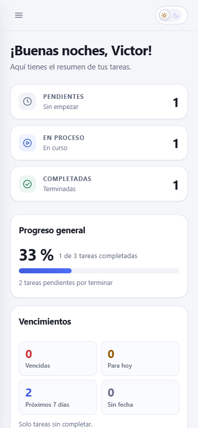
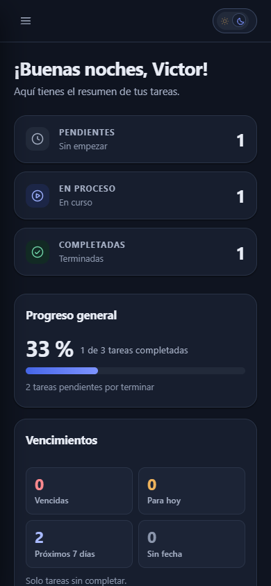

# VPlan

**Aplicación web de gestión de tareas personales.** Prioridades, fechas límite,
estados, filtros y un dashboard con estadísticas, sobre una API REST y una base de
datos MySQL.

Proyecto de portfolio del ciclo de **Desarrollo de Aplicaciones Web (DAW)**:
backend en Java con Spring Boot, persistencia en MySQL con migraciones Flyway y
frontend en HTML, CSS y JavaScript sin frameworks.



## Funcionalidades

- **CRUD completo de tareas**: crear, listar, editar y eliminar.
- **Prioridad** (alta, media, baja), **estado** (pendiente, en proceso, completada)
  y **fecha límite**.
- **Filtros por estado y prioridad**, combinables entre sí.
- **Dashboard** con progreso general, vencimientos, distribución por prioridad y
  estado, carga de los próximos 7 días y próximas tareas.
- **Tema claro y oscuro**: al abrir por primera vez se respeta la preferencia del
  sistema y después manda la última elección guardada en el navegador.
- **Diseño responsive** y navegación completa con teclado.
- **Validación en el servidor** y errores con mensajes claros, sin trazas internas.
- **Migraciones versionadas** de la base de datos con Flyway.
- **34 tests automatizados** de backend.

## Tecnologías

| Capa | Tecnología |
|---|---|
| Lenguaje | Java 21 |
| Backend | Spring Boot 3.5.16 · Spring MVC · Spring Data JPA |
| Base de datos | MySQL 8 · Flyway |
| Frontend | HTML5 · CSS3 · JavaScript (sin frameworks) |
| Build | Maven Wrapper |
| Tests | JUnit 5 · MockMvc · H2 |

## Estructura del proyecto

```text
VPlan/
├─ src/main/java/com/taskflow/    task/ (tareas) y common/ (errores y health)
├─ src/main/resources/
│  ├─ application.yml             Configuración de Spring (sin contraseñas)
│  ├─ db/migration/               Migraciones Flyway (V1, V2)
│  └─ static/                     Frontend: index.html, css/, js/ e img/
├─ src/test/                      Tests de backend con H2
├─ database/                      Scripts SQL de creación y verificación
├─ scripts/                       Arranque, parada, copias y entorno (PowerShell)
├─ docs/                          Guías técnicas, documentación del proceso y capturas
├─ pom.xml                        Dependencias y configuración de Maven
└─ INSTALACION.md                 Guía de instalación, traslado y copias
```

> Los nombres internos (`com.taskflow`, la base de datos `taskflow` y los scripts
> `*-taskflow.ps1`) se mantienen por compatibilidad con la versión anterior.

## Requisitos

- **JDK 21 o superior**.
- **MySQL 8** en marcha en `localhost:3306`.
- Conexión a internet la primera vez, para que Maven descargue las dependencias.

No hace falta instalar Maven, Node, Docker ni un IDE.

## Instalación y ejecución

**1. Crear la base de datos y el usuario.** Ejecuta
[`database/00_create_database_and_user.sql`](database/00_create_database_and_user.sql)
como `root`, cambiando antes `CAMBIA_ESTA_CONTRASENA`:

```powershell
cmd /c "mysql -u root -p < database\00_create_database_and_user.sql"
```

**2. Guardar la contraseña de la aplicación.** El script la pide sin mostrarla y
la guarda en `.env.local`, que está ignorado por Git:

```powershell
.\scripts\set-db-password.ps1
```

**3. Arrancar:**

```powershell
.\scripts\start-taskflow.ps1
```

El script comprueba Java, MySQL y el puerto 8080, arranca la aplicación, espera a
que `/api/health` responda `UP` y abre **http://localhost:8080**.

**4. Parar:**

```powershell
.\scripts\stop-taskflow.ps1
```

Alternativa con Maven directo:

```powershell
. .\scripts\set-dev-env.ps1
.\mvnw.cmd spring-boot:run
```

La guía completa —instalación, traslado a otro equipo, copias de seguridad y
problemas habituales— está en **[INSTALACION.md](INSTALACION.md)**.

## Comprobar que funciona

```powershell
Invoke-RestMethod http://localhost:8080/api/health | ConvertTo-Json
```

El endpoint ejecuta `SELECT 1` contra MySQL y devuelve `status: UP` y
`database: UP`. Si la base de datos no responde, devuelve `503` con
`database: DOWN`.

La aplicación escucha **solo en `127.0.0.1`**, así que el puerto 8080 no queda
accesible desde la red local.

## Comandos habituales

| Comando | Para qué |
|---|---|
| `.\scripts\start-taskflow.ps1` | Arrancar, comprobar el estado y abrir `localhost:8080` |
| `.\scripts\stop-taskflow.ps1` | Parar la aplicación y liberar el puerto 8080 |
| `.\scripts\start-taskflow.ps1 -Foreground` | Arranque en primer plano (depuración) |
| `.\mvnw.cmd test` | Ejecutar los 34 tests (H2, no necesitan MySQL) |
| `.\mvnw.cmd clean package` | Generar el `.jar` en `target/` |
| `.\scripts\backup-db.ps1` | Copia completa de la base de datos |
| `.\scripts\restore-db.ps1 -BackupFile <archivo.sql>` | Restaurar una copia (pide confirmación) |
| `.\scripts\check-no-secrets.ps1` | Comprobar que ningún secreto está escrito en el proyecto |

## API REST

| Método | Ruta | Qué hace | Respuesta |
|---|---|---|---|
| `GET` | `/api/tareas` | Lista todas las tareas | `200` |
| `GET` | `/api/tareas?estado=PENDIENTE&prioridad=ALTA` | Filtra por estado y prioridad | `200` |
| `GET` | `/api/tareas/{id}` | Devuelve una tarea | `200` / `404` |
| `POST` | `/api/tareas` | Crea una tarea | `201` + `Location` / `400` |
| `PUT` | `/api/tareas/{id}` | Actualiza una tarea | `200` / `400` / `404` |
| `DELETE` | `/api/tareas/{id}` | Elimina una tarea | `204` / `404` |

Los errores de validación devuelven un JSON con `status`, `mensaje` y el detalle
por campo. Guía completa: [API REST de tareas](docs/aprendizaje/05-api-tareas.md).

## Capturas

| Tema oscuro | Vista de tareas |
|---|---|
|  |  |

| Móvil claro (390 px) | Móvil oscuro (390 px) |
|---|---|
|  |  |

Las 39 capturas del proceso y las capturas actuales de VPlan están en
[`docs/capturas/`](docs/capturas/).

## Calidad y pruebas

- **34 tests automatizados** de entidad, repositorio, servicio, controlador y
  health, con JUnit 5, MockMvc y H2. Se ejecutan con `.\mvnw.cmd test` y no
  necesitan MySQL.
- Las comprobaciones manuales contra MySQL y la interfaz real (API, teclado,
  responsive, tema oscuro) están documentadas en
  [Fase 8](docs/colaboracion/FASE-08.md) y
  [Fase 9](docs/colaboracion/FASE-09.md). Sus scripts de verificación se
  ejecutaron fuera del repositorio y **no se publican**.
- Método y lecciones aprendidas:
  [Pruebas y calidad](docs/aprendizaje/09-pruebas-y-calidad.md).

## Copias de seguridad

```powershell
.\scripts\backup-db.ps1
```

La copia incluye la tabla `tareas` y el historial de Flyway, y se guarda en
`backups/`, ignorado por Git porque contiene datos personales. Para restaurar, la
aplicación debe estar parada y el script pide confirmación. Procedimiento completo
y prueba segura en
[INSTALACION.md](INSTALACION.md#probar-una-restauración-sin-tocar-tus-datos).

## Documentación

| Documento | Contenido |
|---|---|
| [INSTALACION.md](INSTALACION.md) | Instalación, traslado a otro equipo y copias de seguridad |
| [docs/USO-DIARIO.md](docs/USO-DIARIO.md) | Arranque, parada y copias del día a día |
| [docs/aprendizaje/01-arquitectura.md](docs/aprendizaje/01-arquitectura.md) | Arquitectura y flujo de una petición |
| [docs/aprendizaje/02-base-de-datos.md](docs/aprendizaje/02-base-de-datos.md) | Base de datos y Flyway |
| [docs/aprendizaje/05-api-tareas.md](docs/aprendizaje/05-api-tareas.md) | API REST de tareas |
| [docs/aprendizaje/06-frontend.md](docs/aprendizaje/06-frontend.md) | Frontend |
| [docs/aprendizaje/09-pruebas-y-calidad.md](docs/aprendizaje/09-pruebas-y-calidad.md) | Pruebas y calidad |
| [docs/colaboracion/](docs/colaboracion/) | Documentación del proceso por fases |

## Alcance y seguridad

VPlan es una aplicación **personal y local**, no un servicio multiusuario:

- **Sin autenticación**: no hay usuarios, sesiones ni cookies.
- **Solo accesible en local**: escucha en `127.0.0.1:8080`, no en `0.0.0.0`.
- **No debe exponerse en internet** tal como está: necesitaría autenticación,
  HTTPS y una revisión de seguridad.
- **Credenciales fuera del repositorio**: se leen de variables de entorno y
  `.env.local` está ignorado por Git.
- **Copias de seguridad privadas**: `backups/` y `*.dump` están ignorados.
